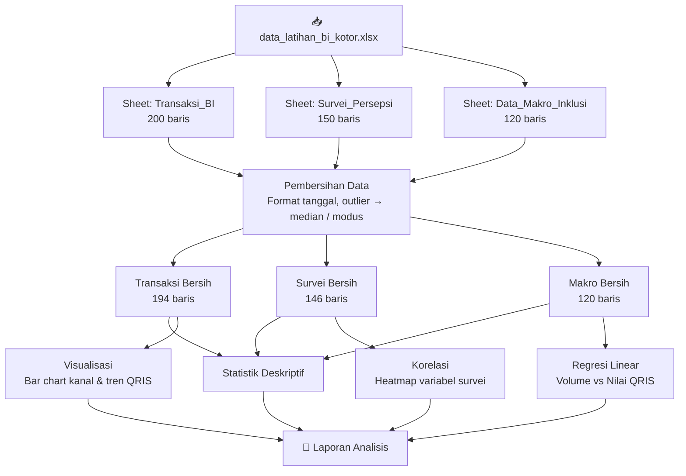
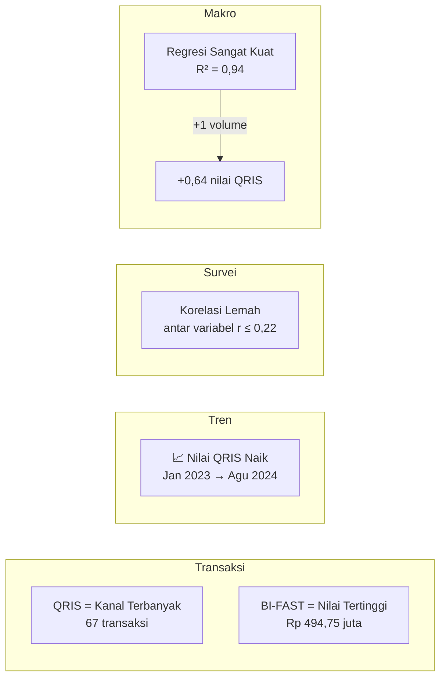

# Analisis Data Transaksi QRIS — Bank Indonesia

Proyek ini berisi analisis eksplorasi terhadap tiga dataset latihan Bank Indonesia menggunakan Python (Jupyter Notebook), mencakup pembersihan data, statistik deskriptif, visualisasi, analisis korelasi, dan regresi linear sederhana.

---

## Struktur File

| File | Deskripsi |
|------|-----------|
| `analisis_data_transaksi_qris.ipynb` | Notebook utama — seluruh alur analisis |
| `data_latihan_bi_kotor.xlsx` | Dataset mentah (3 sheet) |
| `laporan_analisis_bi_lengkap.docx` | Laporan lengkap hasil analisis |

---

## Dataset

Sumber data: `data_latihan_bi_kotor.xlsx`, terdiri dari tiga sheet:

| Sheet | Baris (kotor → bersih) | Kolom Utama |
|-------|------------------------|-------------|
| `Transaksi_BI` | 200 → 194 | Tanggal, Kode Transaksi, Kantor BI, Kanal Pembayaran, Jenis Transaksi, Kategori, Nilai Transaksi, Biaya Admin |
| `Survei_Persepsi` | 150 → 146 | Usia, Jenis Kelamin, Domisili, Pekerjaan, Frekuensi Penggunaan QRIS, Kepuasan Layanan, Persepsi Keamanan, Pengetahuan BI-FAST, Niat Menggunakan Lagi, Loyalitas |
| `Data_Makro_Inklusi` | 120 → 120 | Bulan, Provinsi (6 provinsi), Indeks Inklusi Keuangan, Volume & Nilai Transaksi QRIS, Jumlah Merchant QRIS, Tabungan PDB |

---

## Alur Analisis



1. **Pembersihan Data**
   - Format tanggal: `dd/mm/yyyy`
   - Filter usia wajar: 17–100 tahun
   - Validasi skala: frekuensi QRIS (1–7), skor survei lain (1–5)
   - Nilai negatif/ekstrem → dikosongkan → diisi median
   - Sel teks kosong diisi modus; data makro kosong diisi median per provinsi

2. **Statistik Deskriptif** — mean, median, std, min/max untuk setiap dataset

3. **Visualisasi**
   - Rata-rata nilai transaksi per kanal pembayaran
   - Tren rata-rata nilai transaksi QRIS per bulan
   - Heatmap korelasi variabel survei
   - Scatter plot regresi: volume vs nilai transaksi QRIS

4. **Korelasi & Regresi** — korelasi antar variabel survei + regresi linear sederhana pada data makro

---

## Temuan Utama




### 1. Kanal Pembayaran
- **Transfer BI-FAST** memiliki rata-rata nilai transaksi tertinggi (**Rp 494,75 juta**)
- **QRIS** memiliki rata-rata terendah (Rp 384,35 juta) namun merupakan **kanal terbanyak** digunakan (67 dari 194 transaksi)

### 2. Tren QRIS
- Nilai transaksi QRIS **cenderung naik** dari Januari 2023 (274,62) hingga Agustus 2024 (406,55)
- Puncak tertinggi pada **Juli 2024** (437,30), dengan fluktuasi antarbulan

### 3. Survei Persepsi
- Skor rata-rata berada di tengah skala (2,85–3,16 dari skala 1–5)
- **Tidak ada korelasi kuat** antar variabel survei; korelasi tertinggi: Persepsi Keamanan ↔ Loyalitas (r = 0,22)

### 4. Regresi Data Makro
- **R² = 0,9404**, korelasi = 0,9698 → hubungan **sangat kuat** antara volume dan nilai transaksi QRIS
- Koefisien regresi: setiap +1 unit volume → +0,64 unit nilai transaksi
- Catatan: hubungan ini menunjukkan **keterkaitan, bukan kausalitas**

---

## Catatan Kualitas Data

> ⚠️ Kolom `Nilai_Transaksi` mengandung 10 baris hasil pengisian median (nilai Rp 419.292.000 berulang). Statistik rata-rata dan sebaran pada kolom ini perlu dibaca dengan kehati-hatian.

---

## Dependensi

```
pandas
numpy
matplotlib
seaborn
scipy
openpyxl
```

Jalankan notebook dengan:

```bash
jupyter notebook analisis_data_transaksi_qris.ipynb
```
